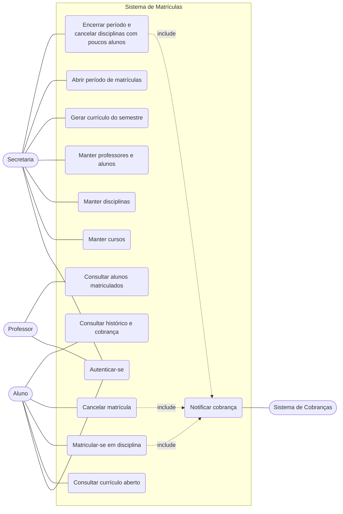
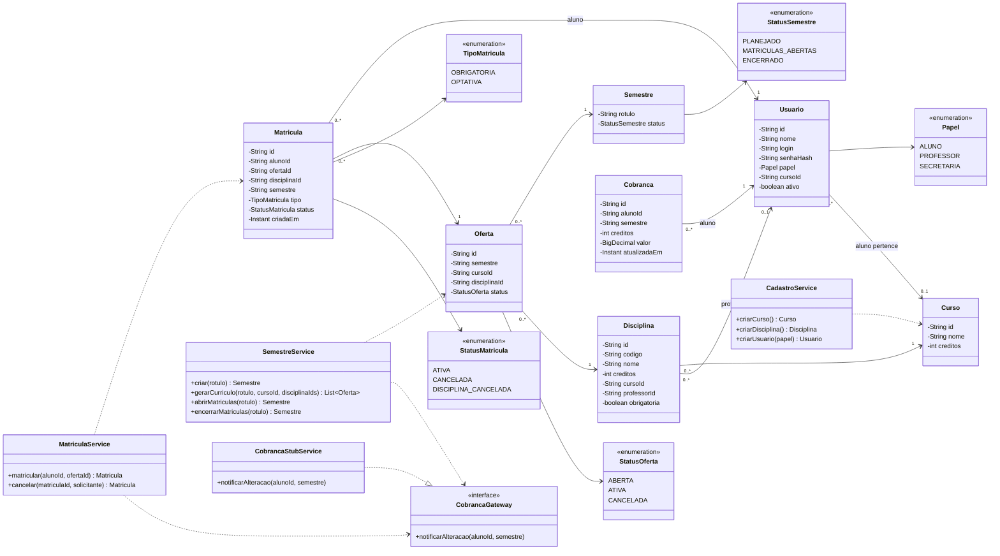
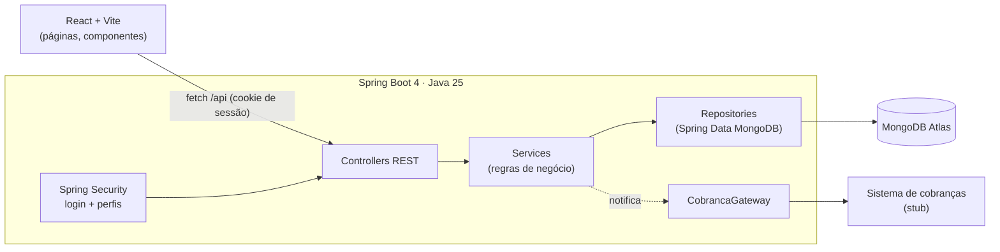
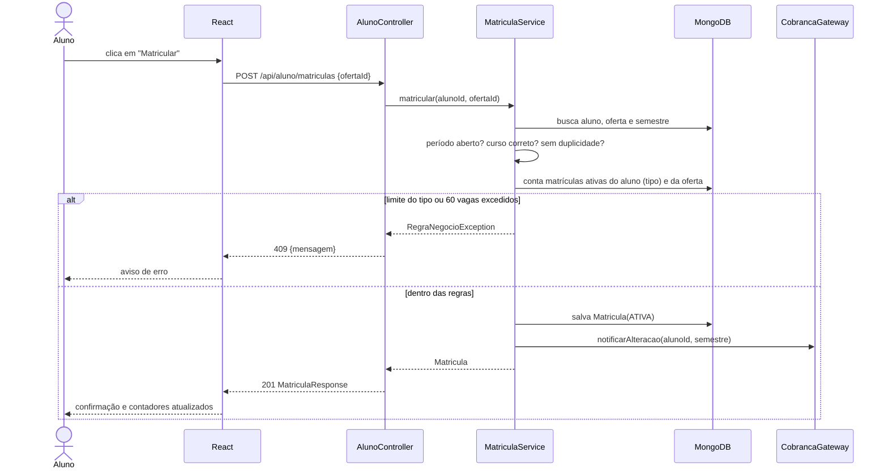

# Meridiano - Sistema de Matrículas

Laboratório 03 de Desenvolvimento e Integração de Aplicações Web (DIAW), Engenharia de Software. É um sistema de matrículas para uma universidade, com back-end em Spring Boot e front-end em React.

A secretaria cadastra cursos, disciplinas, professores e alunos, monta o currículo de cada semestre e abre e fecha o período de matrículas. Cada aluno se matricula em até 4 disciplinas obrigatórias e 2 optativas. Quando o período fecha, disciplina com menos de 3 alunos é cancelada, e cada turma aceita no máximo 60. O sistema de cobranças é avisado a cada matrícula ou cancelamento. Professores consultam os alunos das suas turmas. Todo acesso exige login e senha.

Stack: Java 25, Spring Boot 4, Maven, MongoDB Atlas, React 19 e Vite.

## Casos de uso



## Histórias de usuário

**Autenticação**

- US01. Como usuário (aluno, professor ou secretaria), quero entrar com login e senha para acessar só as funções do meu perfil. Senha errada retorna erro sem dizer qual campo falhou; rota de outro perfil responde 403 e sem sessão responde 401.
- US02. Como usuário, quero encerrar minha sessão para que ninguém use minha conta.

**Secretaria**

- US03. Como secretária, quero cadastrar, editar e excluir cursos (nome e total de créditos). Curso com disciplinas ou alunos não pode ser excluído.
- US04. Como secretária, quero cadastrar disciplinas com código, créditos, curso, professor e tipo (obrigatória ou optativa). O código é único e disciplina já ofertada não pode ser excluída.
- US05. Como secretária, quero cadastrar professores e alunos e definir a senha inicial deles. O login é único, a senha tem no mínimo 6 caracteres e o aluno precisa de um curso.
- US06. Como secretária, quero escolher as disciplinas que serão ofertadas por um curso em um semestre. Só valem disciplinas do curso e só antes da abertura das matrículas.
- US07. Como secretária, quero abrir as matrículas de um semestre para os alunos se inscreverem. Exige currículo gerado.
- US08. Como secretária, quero encerrar o período para confirmar as turmas viáveis e cancelar as demais. Disciplina com menos de 3 alunos é cancelada junto com as matrículas, e a cobrança dos alunos afetados é atualizada.

**Aluno**

- US09. Como aluno, quero ver as disciplinas abertas do meu curso, com professor, créditos e vagas, para decidir onde me matricular.
- US10. Como aluno, quero me matricular em até 4 obrigatórias e 2 optativas por semestre. O sistema bloqueia excesso de disciplinas, turma com 60 inscritos, matrícula duplicada e período fechado.
- US11. Como aluno, quero cancelar uma matrícula enquanto o período estiver aberto, liberando a vaga.
- US12. Como aluno, quero ver meu histórico (ativas, canceladas e disciplinas canceladas) e o valor cobrado por semestre.

**Professor**

- US13. Como professor, quero ver minhas turmas e os alunos matriculados em cada uma. Só aparecem as disciplinas que eu ministro.

**Sistema de cobranças**

- US14. Como sistema de cobranças, quero ser notificado quando as matrículas de um aluno mudarem, para manter a cobrança do semestre correta.

### Regras de negócio

| # | Regra |
| :-: | :-- |
| RN01 | Por semestre, o aluno pode ter até 4 matrículas obrigatórias e até 2 optativas. |
| RN02 | Cada disciplina aceita no máximo 60 alunos. |
| RN03 | Só é possível matricular ou cancelar com o período aberto. |
| RN04 | Ao encerrar o período, disciplina com menos de 3 alunos é cancelada. |
| RN05 | Toda matrícula ou cancelamento notifica o sistema de cobranças. |
| RN06 | O aluno só se matricula em disciplinas do currículo do seu curso. |
| RN07 | Professor só vê os alunos das próprias disciplinas. |
| RN08 | Todo acesso exige login e senha válidos. |

Os limites (4, 2, 60 e 3) e o valor do crédito ficam em `backend/src/main/resources/application.yml`.

## Diagrama de classes

Reflete as classes de `backend/src/main/java/br/edu/matriculas`.



O currículo de um semestre é o conjunto de `Oferta`s (disciplina + semestre + curso). A oferta guarda o estado da turma (aberta, ativa ou cancelada) e é a referência das matrículas.

## Arquitetura



- `controller`: recebe a requisição HTTP, valida a entrada e devolve DTOs.
- `service`: concentra as regras (limites, vagas, período, fechamento de turmas).
- `repository`: acesso ao MongoDB via Spring Data.
- `security`: `UserDetailsService` sobre o MongoDB, BCrypt e autorização por perfil em `/api/secretaria`, `/api/professor` e `/api/aluno`.
- `CobrancaGateway`: interface para o sistema de cobranças. A implementação atual (`CobrancaStubService`) só recalcula e grava a cobrança no próprio banco.

Fluxo de uma matrícula:



## Como rodar

Precisa de JDK 25, Node.js 20+ e um MongoDB (cluster no Atlas ou o `docker-compose.yml` do repositório).

```bash
git clone https://github.com/Cairo74/sistema-matriculas-lab3.git
cd sistema-matriculas-lab3

# MongoDB local, se não for usar o Atlas
docker compose up -d

# back-end em http://localhost:8080
cd backend
./mvnw spring-boot:run        # no Windows: mvnw.cmd spring-boot:run

# front-end em http://localhost:5173 (outro terminal)
cd frontend
npm install
npm run dev
```

Para usar o Atlas, defina a URI antes de subir o back-end e não coloque ela no repositório:

```bash
export MONGODB_URI='mongodb+srv://<usuario>:<senha>@<cluster>.mongodb.net/matriculas'
```

No Atlas, libere seu IP em Network Access.

Variáveis do back-end:

| Variável | Para que serve | Padrão |
| :-- | :-- | :-- |
| `MONGODB_URI` | conexão com o MongoDB | `mongodb://127.0.0.1:27017/matriculas` |
| `SERVER_PORT` | porta da API | `8080` |
| `CORS_ORIGENS` | origens permitidas, se o front não usar o proxy | `http://localhost:5173` |
| `SEED_ENABLED` | cria dados de exemplo se o banco estiver vazio | `true` |
| `SEED_PASSWORD` | senha dos usuários de exemplo | `senha123` |

No front, `BACKEND_URL` muda o destino do proxy do Vite e `VITE_API_URL` define a URL da API em produção (veja `frontend/.env.example`).

### Usuários de exemplo

Criados em banco vazio, todos com a senha `senha123`.

| Perfil | Login |
| :-- | :-- |
| Secretaria | `secretaria` |
| Professores | `helena`, `ricardo`, `beatriz` |
| Alunos de Engenharia de Software | `ana`, `bruno`, `carla`, `diego` |
| Aluna de Sistemas de Informação | `elisa` |

O semestre `2026.2` já vem com currículo e matrículas abertas.

### Build

```bash
cd frontend && npm run build           # gera frontend/dist
cd ../backend && ./mvnw clean package  # gera o jar em target/
```

Em produção, sirva `frontend/dist` atrás de um servidor que encaminhe `/api` ao back-end. Se front e API ficarem em origens diferentes, o cookie de sessão precisa de `SameSite=None; Secure` (HTTPS).

## API

Erros vêm como `{"mensagem": "..."}`. A lista completa de rotas está em [docs/api.md](docs/api.md).

## Testes

```bash
cd backend
./mvnw test
```

Os testes (JUnit 5 e Mockito) cobrem os limites de obrigatórias e optativas, turma lotada, período fechado, matrícula duplicada, curso incorreto, cancelamento e o fechamento do período.

## Limitações

- A sessão é por cookie `HttpOnly` em vez de JWT.
- O sistema de cobranças é simulado.
- A checagem das 60 vagas não é atômica: duas matrículas simultâneas na última vaga podem passar do limite. Em produção seria preciso uma operação condicional ou transação no MongoDB.
- Não há recuperação de senha; a secretaria define as senhas.

## Autor

Cairo74 - [github.com/Cairo74](https://github.com/Cairo74)

Licença MIT, veja [LICENSE](LICENSE).
